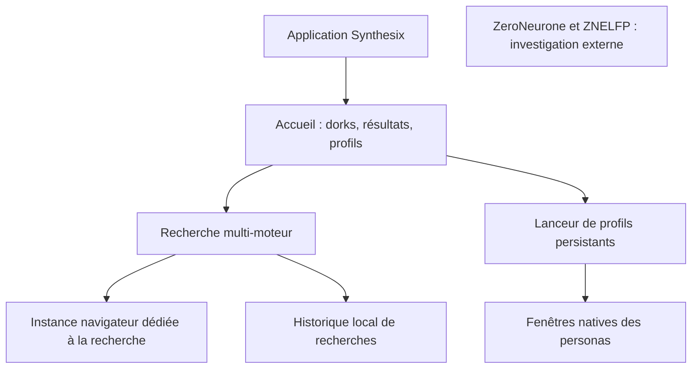

# Synthesix : recentrage sur le navigateur multi-requêtes

Date : 2026-10-30. Statut : état des lieux vérifié et architecture proposée.
Ce document ne décrit pas une refonte déjà implémentée.

## Demande produit établie

Synthesix redevient une application prête à lancer pour construire des dorks,
exécuter plusieurs requêtes et agréger les résultats. Elle permet d'ouvrir des
profils persistants pour les sock puppets. L'utilisateur a confirmé préférer
une application à lancer à une extension à installer dans son navigateur habituel.

Missions, enquêtes, entités, preuves, graphes et monitoring sortent du produit.
Le travail d'investigation revient à ZeroNeurone et à son plugin ZNELFP.
La disparition de ces fonctions ne doit pas supprimer les données existantes.

## État des lieux du code présent

Inspection de l'arbre de travail `feat/lit-frontend`, avec de nombreux changements
non committés antérieurs. Aucun pull, changement de branche ni nettoyage de ces
modifications n'a été effectué.

Les volumes ci-dessous comptent les lignes physiques, commentaires et lignes
vides compris. Ce sont des indicateurs de périmètre, pas des mesures de qualité
ou de performance ; les répertoires ne doivent pas être additionnés aux fichiers
qui leur appartiennent.

| Périmètre | Volume observé | Conséquence |
|---|---:|---|
| `main.py` | 5 312 lignes | Démarrage, recherche, enquêtes, captures, extension et monitoring réunis |
| `investigations/` | 18 015 lignes Python | Une grande partie du produit est devenue un gestionnaire d'enquêtes |
| `investigations/view.py` | 7 451 lignes | Rendu d'enquête particulièrement volumineux |
| `search_orchestrator.py` | 525 lignes | Orchestration réutilisable, avec des responsabilités de rapport/historique à détacher |
| `search_engine.py` | 478 lignes | Interface moteurs et gestion des onglets réutilisables |
| `browser_manager.py` | 625 lignes | Lancement de vrais navigateurs et répertoires de profils déjà présents |
| `browser/service.py` | 1 001 lignes | Services CDP réutilisables, comprenant aussi le transport de l'extension |
| `frontend/src/` | 4 880 lignes TypeScript | Composants Lit à trier selon leur fonction |
| `theme.css` | 5 495 lignes | Styles partagés à réduire après suppression des écrans inutiles |

Couplages vérifiés dans les sources :

- `main.py:3533` initialise obligatoirement `InvestigationService` et sa base,
  puis prépare le cache d'enquêtes, le contexte overlay et le scheduler.
- `main.py:5204` lance la recherche et l'enregistre ensuite via le service
  d'investigation lorsqu'il est fourni.
- `search_orchestrator.py:184` n'importe aucun module d'investigation, mais
  transporte encore `investigation_id` et produit rapport et historique dans
  `search()`. Il constitue une bonne base d'extraction, pas encore un cœur pur.
- `main.py:104` contient déjà `SearchBrowserProvider` : l'automatisation des
  moteurs peut utiliser une instance et un profil distincts de la navigation.
- `browser_manager.py:463` utilise déjà `Config.user_data_dir`. En revanche,
  le produit n'offre pas encore le gestionnaire de plusieurs personas demandé.
- `settings.py:74` rassemble paramètres navigateur, recherche, enquêtes,
  extension et monitoring : cette configuration devra suivre le nouveau périmètre.

Le problème principal constaté est l'accumulation de responsabilités et leur
raccordement dans le démarrage. Ces observations ne prouvent pas que les enquêtes
sont la cause principale des temps de recherche : aucun profilage réel n'a été
effectué pendant cet état des lieux.

## Architecture recommandée

Conserver Python asynchrone, Zendriver et Lit, autour d'un vrai navigateur
Chrome/Brave. Refaire l'assemblage de l'application et ses écrans autour d'un
périmètre beaucoup plus petit, en réutilisant les moteurs et leurs tests.

Le dernier bloc est volontairement indépendant : aucune intégration spécifique
avec ZNELFP n'a été vérifiée. Il ne faut pas inventer de lien ou de contrat.

Trois responsabilités applicatives suffisent :

1. **Rechercher** : composer les requêtes, gérer les moteurs, leurs erreurs,
   délais, annulation, déduplication et classement ; restituer des résultats.
   Le moteur ne connaît ni les dossiers d'enquête ni le rendu des écrans.
2. **Naviguer avec un profil** : créer, nommer, ouvrir et retrouver une persona,
   puis ouvrir un résultat dans sa fenêtre. Le navigateur gère lui-même connexion,
   cookies, stockage, téléchargements et extensions.
3. **Présenter et conserver les recherches** : interface Lit locale et stockage
   léger de l'historique/résultats. Un petit SQLite séparé est proposé si les
   résultats doivent être persistés, sans réutiliser le repository d'enquêtes.

Ce sont des modules d'une même application locale, sans microservices, serveur
obligatoire, framework de plugins générique ou API réseau à maintenir.
Les pages `file://`, bundles classiques et événements CDP peuvent être conservés.
Les commandes privilégiées restent limitées aux pages locales reconnues ; les
pages tierces n'obtiennent pas de pont générique vers Python.

## Gestion des sock puppets

- Une persona correspond à un répertoire `user-data-dir` dédié, persistant.
  Plusieurs fenêtres de cette persona partagent sa session ; deux personas ne
  partagent pas ce répertoire. Empêcher son ouverture concurrente incompatible.
- La connexion aux sites se fait normalement dans le navigateur, une première
  fois par profil. Aucun coffre de mots de passe ni extraction/injection de
  cookies à développer pour satisfaire ce besoin.
- L'interface distingue clairement le profil choisi avant d'ouvrir une URL.
- L'automatisation des moteurs reste dans son profil de recherche distinct,
  sans utiliser les sessions connectées des personas par défaut.
- Le stockage des profils sépare les connexions et données locales ; il ne
  fournit pas à lui seul une adresse IP ou une empreinte machine différente.
- « Sock puppet » ne signifie pas automatiquement proxy SOCKS : un éventuel
  routage réseau par profil reste un besoin distinct à préciser.

Pour limiter la maintenance, commencer avec un navigateur installé et mis à
jour normalement, détecté par le lanceur. Un exécutable Synthesix empaqueté doit
éviter l'installation manuelle de Python/Node. Livrer aussi un navigateur complet
augmente le volume et impose de gérer ses mises à jour de sécurité : ce choix
de distribution reste à trancher.

Les personas peuvent être lancées sans CDP si seule leur ouverture est requise.
Le pilotage CDP reste nécessaire à la recherche et au pont de l'interface locale.

## Alternatives considérées

| Option | Intérêt | Coût ou limite | Position proposée |
|---|---|---|---|
| Lanceur léger + vrai navigateur + cœur Python existant | Réutilisation des moteurs, onglets et fonctions natives | Dépend d'un navigateur installé et de la compatibilité Zendriver/CDP | Recommandée |
| Extension seule | Interface proche du navigateur, moins de Python possible | Ne répond pas au mode de lancement choisi ; orchestration multi-profils et portage des moteurs à résoudre | Non retenue comme produit principal |
| Coque de navigateur Electron | Barre d'adresse, onglets et fenêtres entièrement personnalisables | Réécriture de fonctions navigateur et support partiel des extensions Chrome | À envisager seulement si une coque entièrement personnalisée devient indispensable |
| Fork de Chromium | Contrôle maximal | Maintenance du moteur et des correctifs de sécurité | Disproportionné pour le besoin |

La documentation Electron indique explicitement que la compatibilité avec
toutes les extensions Chrome n'est pas un objectif du projet. Cela constitue
un risque pour un navigateur de travail extensible ; cela ne démontre aucun
problème particulier avec ZNELFP, qui est présenté ici comme plugin ZeroNeurone.

## Ce qui peut rendre l'usage plus rapide

- Démarrer l'accueil sans base d'enquêtes, overlay ni scheduler.
- Créer l'instance de recherche à la demande, comme le permet déjà le provider.
- Afficher les résultats à mesure que les moteurs terminent. Aujourd'hui,
  `SearchOrchestrator.search()` génère son rapport après la collecte globale.
  Un affichage progressif constitue donc une évolution à implémenter et tester.
- Conserver une concurrence bornée, des délais explicites, l'annulation et les
  reprises par moteur ; rendre leurs erreurs visibles sans bloquer les autres.
- Garder l'interface réactive pendant une recherche ou un challenge manuel.

Les gains attendus concernent la simplicité, le démarrage et le délai avant les
premiers résultats visibles. Aucun gain chiffré de vitesse ou de mémoire n'est
annoncé sans mesure. Les moteurs externes et leurs challenges restent variables.

## Ordre de bascule proposé

1. **Préserver l'existant** : conserver les changements Git et données locales.
   Prévoir sauvegarde et accès à l'ancienne version ; vérifier l'export des
   enquêtes utiles avant de retirer leur interface. Ne rien effacer au démarrage.
2. **Livrer un lancement autonome du navigateur recentré** : accueil, dorks,
   recherche et résultats, sans importer `investigations`, `evidence`, `exports`
   ni `analysis`. Extraire les services nécessaires sans seconde implémentation
   durable des moteurs. Garder temporairement l'ancien lancement comme secours.
3. **Ajouter les profils persistants** : créer/ouvrir/renommer, choisir le
   profil d'ouverture des résultats, vérifier isolation et reconnexion réelle.
4. **Rendre la recherche progressive et empaqueter l'application** : premiers
   résultats visibles, annulation, erreurs par moteur, fermeture propre et
   lancement sur une machine sans environnement de développement.
5. **Retirer l'ancien produit** : supprimer les écrans et dépendances d'enquête,
   l'overlay Synthesix et son extension devenus inutiles, puis ajuster tests,
   documentation et graphe d'architecture. Conserver les données historiques.

Chaque étape doit laisser une application lançable. Ne pas transformer les
enquêtes supprimées en une nouvelle plateforme de plugins à maintenir.
Un transfert vers ZNELFP ne se spécifie qu'après lecture de son véritable contrat.
En attendant, les URL peuvent être copiées et ouvertes par les outils existants.

## Critères de réussite de la future bascule

- Lancer Synthesix, faire plusieurs dorks, consulter et filtrer les résultats
  sans créer de mission ou d'enquête.
- Démarrer sans import ni initialisation des anciens modules d'investigation.
- Retrouver les sessions des personas après redémarrage, sans mélange entre
  deux profils, et ouvrir chaque résultat dans le profil explicitement choisi.
- Une panne d'un moteur ne bloque pas les autres ; annuler et relancer reste
  possible ; un captcha peut être résolu manuellement dans le bon contexte.
- Fermer proprement les ressources lancées et ne pas fermer le navigateur
  personnel ou une autre persona par erreur.
- Comparer démarrage, délai du premier résultat et mémoire sur la même machine,
  avec les mêmes requêtes, en séparant fixtures déterministes et réseau réel.

## Vérifications de cet état des lieux

Graphify a servi à localiser les points d'entrée, puis les sources actuelles ont
été lues directement. Les chiffres proviennent des fichiers présents, pas du
graphe. La suite existante `.venv\Scripts\python.exe -m unittest discover`
a exécuté **495 tests en 38,993 secondes, tous réussis**. Cela établit une
référence de non-régression, sans démontrer le fonctionnement des moteurs réels.

Aucun code applicatif ni bundle n'est modifié ici. Aucun test réel de profil,
benchmark navigateur, smoke CDP ou échange ZNELFP n'est effectué pour cette étude.
Le code et le contrat de ZNELFP n'ont pas été identifiés pendant la recherche
documentaire ; sa compatibilité n'est donc pas déclarée validée.

## Sources externes consultées

- [Répertoires de données Chromium](https://chromium.googlesource.com/chromium/src/+/HEAD/docs/user_data_dir.md) : données persistantes et `--user-data-dir`.
- [Restrictions du débogage Chrome](https://developer.chrome.com/blog/remote-debugging-port) : depuis Chrome 136, les flags de débogage exigent un répertoire de données non standard pour Chrome ordinaire.
- [Compatibilité des extensions Electron](https://www.electronjs.org/docs/latest/api/extensions) : API Chrome partiellement prise en charge.
- [Distribution des extensions Chrome](https://developer.chrome.com/docs/extensions/how-to/distribute) : chargement personnel et contraintes de distribution.
